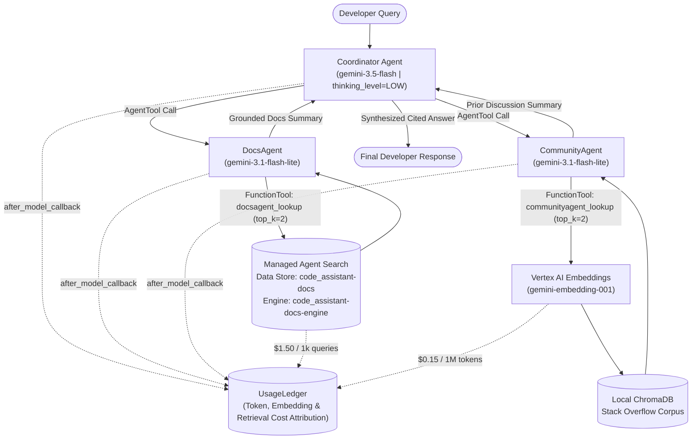

# FDE Cost & Token Estimation, Analysis, and Optimization Challenge Lab

End-to-end solution, documentation, and operational runbook for **Code Assistant Agent: Measure & Optimize the Cost of a Multi-Agent Code Assistant** built on the **Google Agent Development Kit (ADK)**, **Vertex AI Gemini 3 Family**, **Managed Agent Search (Discovery Engine)**, and **Vertex Gen AI Evaluation Service**.

---

## Overview & Scenario

Our team operates **Code Assistant Agent**, an internal developer assistant built with the **Agent Development Kit (ADK)**. When a developer submits a coding question or error message, a **Coordinator** agent orchestrates two specialized sub-agents wrapped as `AgentTool` instances:
- **`DocsAgent`**: Queries official engineering documentation and runbooks hosted on managed **Agent Search** (`Discovery Engine`).
- **`CommunityAgent`**: Queries prior Stack Overflow discussions indexed in a local **ChromaDB** vector store using `gemini-embedding-001`.

While the baseline configuration (`gemini-3.1-pro-preview` Coordinator at `HIGH` thinking effort with `gemini-3.5-flash` sub-agents) achieves high answer quality, operational costs are too high (~`$0.026` per query). A single user query fans out into multiple Coordinator turns, sub-agent tool invocations, document retrievals, vector embeddings, and expensive reasoning ("thought") tokens billed at the output token rate.

### Challenge Constraints & Objectives

To pass the final production challenge on the 16-query held-out evaluation dataset (`assets/eval_holdout.jsonl`), the optimized configuration must simultaneously satisfy:

| Metric / Rule | Requirement | Final Achieved Result | Status |
| :--- | :--- | :--- | :---: |
| **Average Cost per Query** | `<= $0.0135 USD` | **`$0.011054 USD`** | **PASS** |
| **Average Answer Quality** | `>= 0.90` (0–1 normalized scale) | **`0.9375`** | **PASS** |
| **Coordinator Model Tier** | Must be Pro (`gemini-3.1-pro-preview`) or Flash (`gemini-3.5-flash`); **cannot** use `gemini-3.1-flash-lite` | **`gemini-3.5-flash`** | **PASS** |
| **Embedding Model** | Must remain pinned to `gemini-embedding-001` | **`gemini-embedding-001`** | **PASS** |
| **Agent Search Provisioning** | Data Store `code_assistant-docs` & Engine `code_assistant-docs-engine` in `global` | **Provisioned & Indexed (20 docs)** | **PASS** |
| **Metrics Artifact Upload** | Upload `final_metrics.json` to `gs://<PROJECT_ID>-metrics-result/results/final_metrics.json` | **Uploaded & Verified** | **PASS** |

---

## Multi-Agent Architecture



---

## Cost Model & Pricing Contract

All billable events are captured via ADK `after_model_callback` hooks and retrieval tool wrappers into `UsageLedger` (`code_assistant/ledger.py`). Note that **reasoning (`thought`) tokens are billed at the model's output token rate**.

| Component / Model | Input ($ / 1M tokens) | Cached Input ($ / 1M tokens) | Output + Thought ($ / 1M tokens) | Flat / Per-Unit Rate |
| :--- | :---: | :---: | :---: | :---: |
| `gemini-3.1-pro-preview` | `$2.00` | `$0.20` | `$12.00` | — |
| `gemini-3.5-flash` | `$1.50` | `$0.15` | `$9.00` | — |
| `gemini-3.1-flash-lite` | `$0.25` | `$0.025` | `$1.50` | — |
| `gemini-embedding-001` | — | — | — | `$0.15` / 1M input tokens |
| `vais_query` (Agent Search) | — | — | — | `$1.50` / 1,000 queries (`$0.0015`/query) |

---

## Optimization Levers & Engineering Analysis

### 1. Baseline Audit (Part 1)
- **Configuration**: `Coordinator = gemini-3.1-pro-preview` (`thinking_level="HIGH"`), `DocsAgent = gemini-3.5-flash`, `CommunityAgent = gemini-3.5-flash`, `top_k = 3`.
- **Finding**: The Coordinator dominates the per-query bill (~`$0.026/query`) because `gemini-3.1-pro-preview` at `HIGH` thinking generates hundreds of thought tokens per turn billed at `$12.00 / 1M` tokens across both the tool-planning turn and final synthesis turn.

### 2. Lever 1 — Model Selection & Tiering (Part 2)
- **Step 1a (Coordinator Pro -> Flash at HIGH thinking)**: Tiering the Coordinator down to `gemini-3.5-flash` cuts cost by ~25–40% while preserving quality within judge noise. Flash tokens are cheaper (`$1.50/$9.00` vs `$2.00/$12.00`) and Flash expends fewer reasoning tokens on the same orchestration task.
- **Step 1b (Coordinator -> Flash-Lite trap)**: Tiering the Coordinator all the way down to `gemini-3.1-flash-lite` at `HIGH` thinking causes severe run-to-run cost and quality instability (tool-calling misfires, retries, and runaway reasoning loops). **Lesson**: Keep the Coordinator on a capable orchestration tier (`gemini-3.5-flash`), but **tier the sub-agents (`DocsAgent` and `CommunityAgent`) to `gemini-3.1-flash-lite`**, where they only perform single-step lookup summarization (`6x` cheaper per token than `gemini-3.5-flash`).

### 3. Lever 2 — Context Caching & Semantic Caching (Part 3 & Part 5 Bonus)
- **Explicit Context Caching**: Reduces repeated large prefix input costs by **90%** (`$0.15` vs `$1.50` per 1M tokens on `gemini-3.5-flash`), requiring a minimum prefix of 4,096 tokens.
- **Semantic Response Cache**: Uses `gemini-embedding-001` cosine similarity (`threshold=0.85–0.92`) to serve paraphrased repeat questions for the cost of a single embedding call instead of running the full multi-agent pipeline.

### 4. Lever 3 — Reasoning & Retrieval Token Reduction (Part 4)
- **Step 3a (`thinking_level="LOW"`)**: Lowering the Coordinator's thinking level from `"HIGH"` to `"LOW"` drastically collapses `thought_tokens` overhead without sacrificing synthesis accuracy on developer Q&A.
- **Step 3b (`top_k=2`)**: Trimming retrieval breadth from `3` to `2` snippets per lookup reduces sub-agent prompt input tokens and shrinks sub-agent responses fed back into the Coordinator.

---

## Final Challenge Configuration (Part 6)

Combining Coordinator tiering, **sub-agent tiering to `gemini-3.1-flash-lite`**, `LOW` reasoning effort, and `top_k=2` retrieval breadth unlocks the passing configuration in `code_assistant_cost_optimization.ipynb`:

```python
MY_MODELS = {
    "coordinator": "gemini-3.5-flash",      # Reliable orchestration tier
    "docs":        "gemini-3.1-flash-lite", # 6x cheaper sub-agent lookup summarization
    "community":   "gemini-3.1-flash-lite", # 6x cheaper sub-agent lookup summarization
    "embedding":   "gemini-embedding-001",  # Required embedding model
}
MY_THINKING = "LOW"   # Eliminates unnecessary Coordinator thought-token overhead
MY_TOPK     = 2       # Leaner retrieval context per sub-agent lookup
MY_MAXOUT   = None    # Preserves default 3,072 safety ceiling without starving answers
```

### Final Evaluation Metrics (`final_metrics.json`)

```json
{
  "cost_per_query": 0.01105398125,
  "quality": 0.9375,
  "budget": 0.0135,
  "quality_floor": 0.9,
  "passed": true
}
```

---

## Repository Structure

```text
├── README.md                                  # Project overview, architecture, and results summary
├── RUNBOOK.md                                 # Step-by-step execution guide and operational runbook
├── code_assistant_cost_optimization.ipynb     # Completed lab notebook with Final Challenge solution
├── run_challenge.py                           # Automated CLI script for provisioning & challenge eval
├── final_metrics.json                         # Verified evaluation output uploaded to GCS
├── assets/
│   ├── docs.jsonl                             # Official engineering docs corpus (20 documents)
│   ├── stackoverflow.jsonl                    # Community Stack Overflow corpus (ChromaDB index)
│   ├── eval_dataset.jsonl                     # 15-query development evaluation dataset
│   └── eval_holdout.jsonl                     # 16-query held-out final challenge dataset
└── code_assistant/
    ├── __init__.py
    ├── agents.py                              # ADK Coordinator, DocsAgent, CommunityAgent & callbacks
    ├── data.py                                # JSONL dataset loader
    ├── display.py                             # HTML metric card & PASS/FAIL verdict renderers
    ├── ledger.py                              # UsageLedger for per-query & per-component attribution
    ├── quality.py                             # Vertex Gen AI Evaluation Service pointwise judge wrapper
    ├── retrieval.py                           # Vertex AI embedding & ChromaDB lookup tools
    └── vais.py                                # Discovery Engine (Agent Search) provisioning & search
```

---

## Quick Start

See **[RUNBOOK.md](./RUNBOOK.md)** for complete step-by-step instructions to run this lab either via **Vertex AI Workbench JupyterLab** or directly from **Cloud Shell / Terminal** using `run_challenge.py`.
